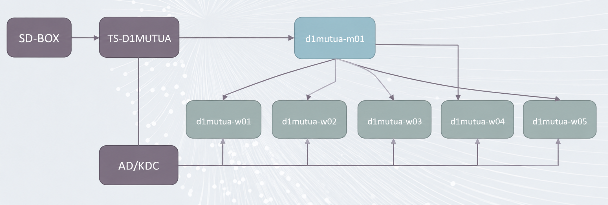
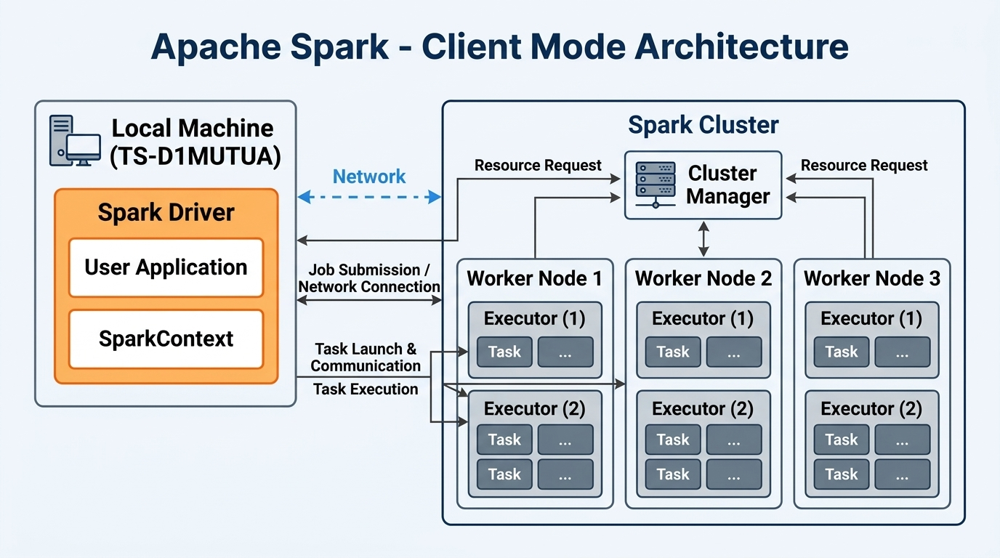
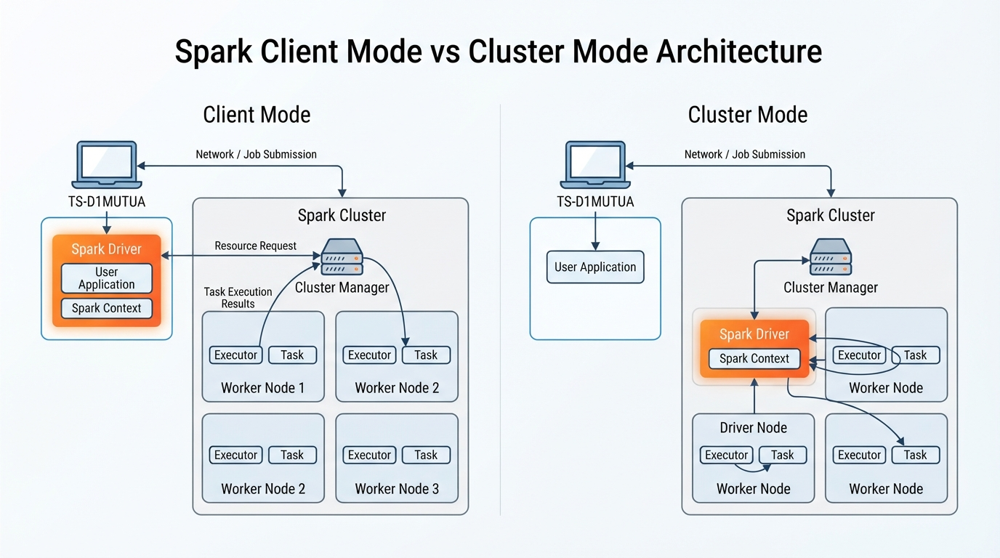

# CASD spark/hdfs cluster onboarding

This tutorial aims to help you to be familiar on how to use spark/hdfs cluster inside bulle D1MUTUA.

We will follow the below steps in this tutorial.

- understand the general architecture of the cluster
- check web interface access of the cluster
- check hdfs client of the cluster
- check spark client of the cluster
- check sparklyr client of the cluster

## 1. Architecture of the cluster

The below figure shows the general architecture of the cluster



- The `TS-D1MUTUA`: is the main server(Windows) which you connect to via the `SD-BOX`.
- The `d1mutua-hdp-m01, d1mutua-hdp-w01/w02/w03/w04/w05`: are the servers which form the spark/hdfs cluster. The end users can not access 
    them directly, but through spark/hdfs client which are installed/configured on `TS-D1MUTUA`.

## 2. Check web interface access of the cluster

This step happens inside the `TS-D1MUTUA` server (Windows).

You can visit the following url by using the `Firefox` web browser.

- [hdfs web interface](https://d1mutua-hdp-m01.casd.fr:50470/explorer.html) : is the web interface which allows users to view directories and data in the hdfs cluster.
- [spark web interface](https://d1mutua-hdp-m01.casd.fr:8090/) : is the web interface which allows users to view spark jobs and available resources of the cluster. 

> There is a shortcut created in `Bureau`->`Raccourcis`->`Cluster_2026`. You only need to double-click on it. A `Firefox` web browser
> will be opened automatically.
>
> The first connection may take few seconds, because of the kerberos ticket and user groups checking.
> You may also need to accept the certificat if you see warnings.
  
## 3. Install Spark, HDFS client

To facilitate the installation of Spark and HDFS client, CASD has developed an installation script. 

You can find this script in `C:\RO_Cluster\install_spark.ps1`.

Open a `powershell terminal`, and run the below command

```powershell
cd C:\RO_Cluster

#run the installation script
 .\install_spark.ps1
```

> After this step, you will be prompted with two questions: 
>   1. which spark version you want to install? choose 4.1.3 
>   2. Confirm you choice.
> If you encounter any error in this step. copy the error message and send to `datascience@casd.eu`


## 4. Check the hdfs client access

Open a new `powershell` terminal, and run the below command

```shell
# check the hdfs file system
hdfs dfs -ls /

# check user home folder, replace your_user_name by your current D1MUTUA user name(e.g. D1MUTUA_P_LIU0000).
hdfs dfs -ls /users/<your_user_name>

# for the first time, if you have not upload any data, the output will be empty.

# If you already have data, for example, for /users/D1MUTUA_P_LIU0000, you should see the below output
-rw-------+  3 D1MUTUA_P_LIU0000 hadoop         76 2026-03-06 11:18 /users/D1MUTUA_P_LIU0000/stats.csv
drwx------+  - D1MUTUA_P_LIU0000 hadoop          0 2026-03-10 17:16 /users/D1MUTUA_P_LIU0000/tmp
```

> You can only access your own home folder. If you try to access the home folder of other users, you should see `Permission denied` error.

You can also try to access the project folder

```shell
# check the projects folder
hdfs dfs -ls /projects

# try to access a project 
hdfs dfs -ls /projects/BCL_EEC
```

> If you are not in group `BCL_EEC`, you should see `Permission denied` error.


### 4.1 The demo folder

CASD has prepared some demo data and demo scripts to help user to use the spark cluster. To avoid conflicts between
users, we require you to **copy this demo Folder to your personnel documents folder**.

Use the same `powershell` terminal of the above section 4

```powershell
# copy demo folder
Copy-Item -Path "C:\Users\Public\Documents\demo" -Destination "$HOME\Documents" -Recurse

# goto your personnel documents folder
cd "$HOME\Documents\demo"

# check if you have the demo folder
ls
```

> You should see the contents of the demo folder in the output


### 4.2 transfer data between TS-D1MUTUA and HDFS cluster

As `spark` is a framework for distributed computing, the data must be also distributed. That's why `spark` can't use 
data from the local file system of `TS-D1MUTUA` server. As a result, we must transfer data from `local file system` 
to `hdfs cluster`

Use the same `powershell` terminal of the above section 4.1 

```shell
# check data in the local file system
ls 01-hdfs

# you should see stats.csv in the output.
# goto the 01-hdfs folder
cd 01-hdfs

# now upload data  from `local file system` to `hdfs cluster`
# replace your_user_name by your current D1MUTUA user name(e.g. D1MUTUA_P_LIU0000).
hdfs dfs -put stats.csv /users/<your_user_name>/

# check the data in hdfs
hdfs dfs -ls /users/<your_user_name>/

# download data from `hdfs cluster` to `local file system`
# "$HOME\Documents" means the `Documents` folder in `TS-D1MUTUA`
hdfs dfs -get /users/<your_user_name>/stats.csv "$HOME\Documents"
```

> The `TS-D1MUTUA` server is a Windows server, so the directory separator is `\`, the HDFS cluster servers
> are Linux servers, so the directory separator is `/`. When your data is in HDFS, use `/`, if your data is in 
> `TS-D1MUTUA`, use `\`.

## 5 Use sparklyr to connect to the spark cluster in interactive mode

The only way to interact with the spark cluster via `R` is to use the `sparklyr` package in `client mode` interactively. 
To facilitate the usage of sparklyr with the kerberos authentication with the cluster, CASD has developed a `sparklyr wrapper`. 
This wrapper is installed automatically by the `CASD Spark Installer`. It manages the entire lifecycle of the authentication token with the spark cluster .
We will use the below code example to illustrate how to use this `sparklyr wrapper` to create connect to the spark cluster.

> The package `SparkR` is deprecated as of Apache Spark 4.0 and will be removed in a future release. So CASD does not 
> support this package anymore.

> Don't worry if you don't understand some term such as `client mode`, we will explain it later. 

You can find the complete R script of this example in `Documents\demo\04-sparklyr`, which allows you to create a spark session with 
the CASD sparklyr wrapper on the cluster. It also demonstrates how to use R to read data from HDFS, and write results on the HDFS

This script has four important blocks
1. Importing CASD sparklyr wrapper 
2. Configure spark session parameters(e.g. executor number, CPU and memory per executor, etc.)
3. Initiate spark session with CASD sparklyr wrapper 
4. Close the spark session

###  5.1 Importing CASD sparklyr wrapper 

The below R script shows how to import the `CASD sparklyr wrapper`. First, you need to install and import two R packages `sparklyr` 
and `dplyr`. Then you import the `CASD sparklyr wrapper`.

> **You can reuse the below code for any R script. Do not modify it**

```R
# The wrapper reqires the below packages, you only need to install it once
install.packages("sparklyr")
install.packages("dplyr")

# Dynamically extract the current username
current_user <- Sys.info()[["user"]]
message(sprintf("Running Spark session for OS User: %s", current_user))

# Construct CASD sparklyr wrapper path
casd_conf_path <- file.path(
  "C:", "Users", current_user, "AppData", "Local", 
   "casd-tools", "casd-token-conf", "casd_spark.R"
)
# import CASD sparklyr wrapper
if (file.exists(casd_conf_path)) {
  source(casd_conf_path, encoding = "UTF-8")
} else {
  stop(sprintf("Configuration script not found at expected path: %s", casd_conf_path))
}
# import the required package
library(sparklyr)
library(dplyr)
```

> If you see error message such as `Configuration script not found at expected path`, It means your spark installation 
> process does not end correctly. Try to rerun the installation script, if you still have this error message, please contact `datascience@casd.eu` and send us
> the detailed error message stack.

### 5.2 Configure spark session parameters

Based on your job specifications, you can ajuster your spark session parameters such as:
- executor numbers
- executor cpu, memory
- driver cpu, memory

The below code is an example of how we set up basic spark session parameters. With this config, your spark session 
has:
- one driver with 1 vcore, 2 Gb memory
- two executors with 1 vcore, 2 Gb memory

> Based on your job, you can increase the number of executors, or the cpu and memory of executors. 
```R
# ==============================================================================
# 1. Cluster Configuration & Network Settings
# ==============================================================================
config <- spark_config()

# spark cluster Resource Allocation
config$spark.executor.instances <- 2
config$spark.executor.cores     <- 1
config$spark.executor.memory    <- "2g"
config$spark.driver.memory      <- "2g"
config$spark.driver.cores      <- 1
```

The below configuration set up the network and security, you don't need to modify them

```R
# Network & Connectivity
config$spark.driver.bindAddress <- "0.0.0.0"
config$spark.submit.deployMode  <- "client"


# Security Tokens for HDFS and Hive metastore delegation
config$spark.yarn.security.tokens.hdfs.enabled <- "true"
config$spark.yarn.security.tokens.hive.enabled <- "true"
```

### 5.3 Initiate spark session with CASD sparklyr wrapper

Now we have all we need to initiate a spark session, let's start our spark session. This may take few seconds, please be
patient.

The below code shows an example on how to initiate spark session with CASD sparklyr wrapper, you can notice the syntax is
a bit different from the standard sparklyr package.

```R
# Establish YARN Connection
sc <- casd_spark_connect(master = "yarn", config = config)
```

> You may see some error messages about when sparklyr updating Rstudio connection pane: Rstudio can't find log file `logs/log4j.spark.log`
> This error message does not impact the execution of your sparklyr code, you can just ignore it

Once the spark session is created, you can do your usual sparklyr data analysis, this is zero syntaxe change.

### 5.4 Close the spark session

After you finish your analysis, you need to close your spark session. Otherwise, `the reserved resource can not be used by
other users`. And If all the resources of the cluster are reserved, **no one can start a new spark session anymore**.

```R
# close the spark session and free the resources
casd_spark_disconnect(sc)
```

> If you want to restart a spark session, you need to restart the R kernel to generate a new cluster authentication token.


## 6. Create and submit a spark job


### 6.1 Check the spark client access

In this section, we will test if you can use the spark client to connect to the cluster.
Use the same `Powershell terminal of section 4.1`.


First check if you have spark installed correctly in your environment. 

```shell
# check current spark runtime version
spark-submit --version

# you should see the below output
Welcome to
      ____              __
     / __/__  ___ _____/ /__
    _\ \/ _ \/ _ `/ __/  '_/
   /___/ .__/\_,_/_/ /_/\_\   version 4.1.3
      /_/
                        
Using Scala version 2.13.17, OpenJDK 64-Bit Server VM, 17.0.18
Branch HEAD
Compiled by user on 2026-07-12T02:17:43Z
...

```

### 6.2 Submit a spark job written in python 

We already created a pyspark job in `demo\02-spark-submit`, it's called `job1.py`.


```powershell
# go to the 02-spark-submit folder
cd "$HOME\Documents\demo\02-spark-submit"

# you can view the content of the job1.py
cat .\job1.py
```

To submit this job to the cluster, you need to run the below command

```shell
# don't forget to replace your_name
spark-submit --master yarn --deploy-mode cluster --name=test_spark_submit_<your_name> job1.py
```

> You can notice in the above `spark-submit` command, there are two important options
> - master is yarn : yarn is the resource manager(which job run on which worker node).
> - deploy-mode cluster: spark driver will also run on the cluster side. So nothing runs inside 
> `TS-D1MUTUA` server. As a result, you don't need to activate python environment and pyspark
> You can check the status of your job via [yarn web UI](https://d1mutua-hdp-m01.casd.fr:8090/cluster).
> We will see how to `run spark in client mode` in the next section. 

> **The spark-submit commands only works in Powershell terminal**. The spark job must be written in `Python, Scala, or Java`,
> as a result, **R is not supported in spark-submit**.
 
> To make the cluster token management is completely transparent for the end user, CASD has written
> a script which overwrites the origin `spark-submit` command. This script is only activated in Powershell.
> As a result, the `spark-submit` command will ont work in `CMD terminal` .


## 7 Use pySpark to connect to the spark cluster in interactive mode

We have seen how to use `sparklyr` to connect to the spark cluster. For python user, you have a package called `pySpark`
which allow you to run your spark job interactively(client mode). 

In this mode the `spark driver` runs on `TS-D1MUTUA` server. So we need to install a `python virtual environment and pyspark`

To do so, we need to open an `anaconda terminal`. Goto `Raccourcis`-> `Python`, double-click on `Miniconda Prompt Python3.13`, 
you should see a popup `anaconda terminal`. Now you can run the below command to create a `python virtual environment`.

```shell
# check your python version
python -V

# create a virtual env with the current python interpreter version
conda create -n spark_venv python --offline

# list all existing virtual env
conda env list

# you should see spark_venv in the output

# activate the python virtual venv
conda activate spark_venv

# check installed libs
pip list

# install pyspark, the pyspark version must match the spark version in the cluster
pip install pyspark==4.1.3

# install jupyterlab
pip install jupyterlab
```

Now you have all the required dependencies to use spark cluster in interactive mode with `pyspark`.

> The `conda` command only visible in `anaconda terminal`. If you open a `powershell` or `cmd` terminal, the command `conda` 
> does not exit inside them. So if you want to use **python virtual environment**, you need to
> goto `Raccourcis`-> `Python`, double-click on `Miniconda Prompt Python3.13`, to open an `anaconda terminal`.
> 

To check if your installation is successful or not, let's close the existing `Miniconda Prompt Python3.13`, and open
a new one.

```powershell
# goto your Documents\demo\03-notebooks
cd Documents\demo\03-notebooks

# if you open a new `anaconda terminal`, don't forget to activate the `virtual environment(e.g. spark_venv)` 
conda activate spark_venv

# if you are already in the activated `virtual environment(e.g. spark_venv)`, you can run the below command
# to open a jupyter lab.
jupyter lab --port=0

# In the GUI, create a new jupyter notebook and copy the below code in it
```

> The option `--port=0` is very important. If you forget this option, you may see error messages `Port already in use`.
> Normally a browser will be launched automatically. If you don't see a browser, you can open a firefox and copy
> the jupyterlab url in the firefox.

In the notebooks, you should find a jupyter notebook called `01.pyspark_read_write_hdfs.ipynb`

You can run the blocks one by one and check the outputs of the blocks

The most important blocks are:
- importing CASD pyspark wrapper: The CASD pyspark wrapper take care of cluster authentication token automatically
- initiate spark session with CASD pyspark wrapper
- close the spark session

The below code shows a simple code example

```python
######### Import CASD pyspark wrapper ########
import getpass
import sys
from pathlib import Path

# Add CASD custom library path before imports
CASD_LIB_PATH = Path.home() / "AppData" / "Local" / "casd-tools" / "casd-token-conf"

# check before launch
if CASD_LIB_PATH.exists():
    sys.path.append(str(CASD_LIB_PATH))
else:
    print(f"[WARNING] Custom library path does not exist: {CASD_LIB_PATH}")
    
# import casd spark wrapper
from casd_spark import get_spark

############### initiate spark driver  ##############
# get user name
username = getpass.getuser()
# set spark job name
app_name = f"test_pyspark_for_{username}"

print(f"[INFO] Initializing Spark Session: {app_name}")
spark = get_spark(app_name=app_name)
```

The block 7 will write the result in CSV format in your hdfs home folder `/users/<user-name>/tmp/count_resu_csv`

The block 8 will write the result in Parquet format in your hdfs home folder `/users/<user-name>/tmp/count_resu_parquet`

The block 9 will do two import things:
1. Close the connection between your spark client and spark cluster, hence free all the reserved resource in the cluster.
2. Revoke the authentication token which allows you to connect to the cluster. It means you cannot create a new spark session
on the cluster anymore. To generate a new authentication token, you need to click on the `Restart the kernel` button.

## 8. How to size your spark session

In this section, we explain several best practices for sizing your Spark session relative to your data volume.
Before we start, let's understand some terms:
- `worker node`: is a physical or virtual machine that provides CPUs, RAM, and local disk space. It can host `one or multiple executors`,
       depending on how much CPU and memory the node has and how you configure your executor sizes.
- `cluster manager`: is the `resource orchestrator` that sits between your Spark application (the Driver) and the underlying physical or virtual machines (Worker Nodes) 
           in a distributed cluster. In our case, the cluster manager is `YARN`.
- `executor`: is a distributed JVM process launched on a `worker node` for the lifetime of a Spark application. It stores 
         cached/persisted data partitions in memory or on local disk, then executes individual tasks (each task typically processes one data partition) 
            using a pool of threads corresponding to its assigned CPU cores
- `driver`: is a process which translates user commands(e.g. R/Python scripts) into a DAG(Directed Acyclic Graph) of execution stages and tasks. Then
 it schedules tasks onto executors and collects results or status updates back from them.

The below figure shows the architecture of a spark application in client mode.



### 8.1 General rules

Below we list some general rules on how to size your spark session:
- `data partition size`: The optimum data partition size should be between 100MB and 200MB. If your partitions are 
        too small (<10 MB), task scheduling overhead will overwhelm processing time (the "small files problem"). 
        If they are too large (>500 MB), you risk Out-Of-Memory (OOM) errors during shuffles. In our case, the data stored in
     the HDFS has the default partition size 128MB.
- `executor memory size`: Keep executor memory sizes between `32 GB and 64 GB`. Because executor is a JVM process, and the 
        Java Garbage Collector (GC) struggles with heaps larger than 64 GB.  
- `executor core size`: Keep executor core size between `2 and 6, commonly 4`. Giving an executor too many 
         cores (e.g., 16+) creates high I/O contention on the local disk and network interfaces, and hurts HDFS 
         client throughput. Giving it only 1 core destroys parallelism and multi-threading efficiency. 
- `driver core and memory size`: In general the driver only collects metadata and coordinates tasks. So 4Gb to 8GB memory and 2 core
        should be enough. It should `never brought large dataset(in the executor) back` via actions like `collect(), take()`
         If you want check the intermediate results, you can use functions such as `head(5) or sdf_limit(5)` to collect
         only the first 5 rows of the dataframe. If you have to collect the entire dataset, you need to increase the driver
         memory accordingly. 


### 8.2 A real world example

In our case, we have 5 worker nodes, and each worker nodes has 8 cores and 150 GB RAM. Suppose we have two datasets 
of 200GB each. We need to do an inner join between two and then a groupby + aggregation operations.

To have the best execution efficiencies, we can use the below spark session sizing.

```text
# Executors (4 per node x 5 nodes = 20 executors, 40 total cores)
spark.executor.instances                      = 20
spark.executor.cores                          = 2
spark.executor.memory                         = 24g
spark.executor.memoryOverhead                 = 6g

# Driver
spark.driver.cores                            = 2
spark.driver.memory                           = 8g

```

- Executor instance number: to maximize the parallelism, we reserve 2 core per executor, it means we can have 20 executor instances
  (4 per worker node). It means we can have `40 tasks execution in parallem`.
- Executor memory: normally 8GB memory for 1 core is enough, but our job need to do join and groupby which will lead wide shuffle, so we add another
        4GB memory to avoid OOM(out off memory) error.

## 9. Client mode(sparklyr interactive) vs Cluster mode(spark-submit) 

We have presented the two major ways to use the spark cluster:
- Interactive(client mode) : R via sparklyr, and python via pyspark
- Batch(cluster mode) : spark-submit via pyspark

There are huge difference between the two modes, the below figure shows the architectural difference.

.

You can notice that in client mode, the `spark driver process` runs on your local machine(e.g. `TS-D1MUTUA`), in cluster
mode, all run on the cluster side(zero resource usage in `TS-D1MUTUA`).

### 9.1 When to use spark-submit(Cluster mode) 

When working with an `Apache Spark cluster`, compare to an `interactive sparklyr session`, the batch deployment via `spark-submit` 
offers several architectural, operational, and performance advantages.
- `Cluster deploy mode`: As we explained before, the `interactive sparklyr` only supports the client mode, where 
     the `spark driver process` runs on your local machine(e.g. `TS-D1MUTUA`). With cluster mode, all processes run on 
     the cluster(even the spark driver). It means Zero resource used inside `TS-D1MUTUA`.
- `Job Lifecycle Independence`: the `interactive sparklyr` requires you keep an active and uninterrupted R session for 
          the entire duration of the job on your local machine. If your connection drops, the job dies. With `spark-submit`,
          once the job is submitted, the submitting client can safely disconnect. The job will be placed in a queue, when
          resource is available, the job will be started and run on the cluster until completion.
- `Minimized Network Latency`: With `interactive sparklyr`, as the spark driver process runs on your local machine(e.g. `TS-D1MUTUA`), 
    the `driver-to-executor` communication between your local machine and the cluster is mandatory, if your spark job 
       requires frequent data collections, this can cause substantial network saturation. With `spark-submit`, the driver 
       lives inside the cluster infrastructure alongside the worker nodes, this can avoid network saturation.
- `Predictable Resource Governance`: Interactive sessions tend to hold cluster resources open for long periods or idle durations.
        With `spark-submit`, the reserved resources are released immediately upon job completion.

With the above advantages, the cluster mode is more suitable for 
- `production environments`: If the data pipeline is mature and stable, and your spark job is in production.
- `automated pipelines`: If your spark job is triggered by orchestrators like Apache Airflow, cron, or CI/CD pipelines.
- `long-running job`: If your spark job take hours or days to finish, it's better to use cluster mode. 

### 9.2 When to use sparklyr interactive

Client mode offers several distinct advantages, particularly during the data exploratory, data pipeline development, 
and debugging phases:
- `Fast feedback`: In client mode, you can run commands line-by-line, and preview intermediate results at all time
- `Simplified Debugging`: When an error or exception occurs, the full stack trace appears directly in your local R console. 
       You don't have to hunt through distributed cluster log files
- `local file interaction`: The driver process runs on your local machine, making it extremely easy to read local files, 
              load small lookup datasets from your local disk and interact with the intermediate results.

With the above advantages, the client mode is more suitable for
- `Data Exploration`: If you are writing code line-by-line, inspecting data frames to understand your dataset.
- `Prototyping and Debugging Complex data pipeline`: If you are prototyping a complex data pipeline, and encounter bugs.
- `Local file system access`: If you need to read small local lookup tables, or write temporary artifacts directly to 
          your local workstation during a test run.

  
## 10. Advance optimization

Above all, spark is a distributed computing framework which depends on heavily how the data is partitioned. If the data
partition is misconfigured, the computing efficiency will be heavily impacted.

Let's resue the above example, 
To make your spark job more efficient, 


Adjusting Shuffle Partitions (spark.sql.shuffle.partitions)Default Trap: The default Spark configuration is 200 shuffle partitions, which is disastrously wrong for both extremes:For small data (<10 GB), 200 partitions creates unnecessary overhead; lower it (e.g., to 10–50).For large data (Terabytes), 200 partitions will crush your executors with massive memory blocks.Rule of Thumb: Aim for each shuffle partition to contain roughly 100 MB to 200 MB of data.Formula: $\text{Shuffle Partitions} = \frac{\text{Estimated Dataset Size post-shuffle}}{\text{128 MB}}$. (Alternatively, enable Adaptive Query Execution (AQE) via spark.sql.adaptive.enabled = true, which automatically coalesces shuffle partitions at runtime).