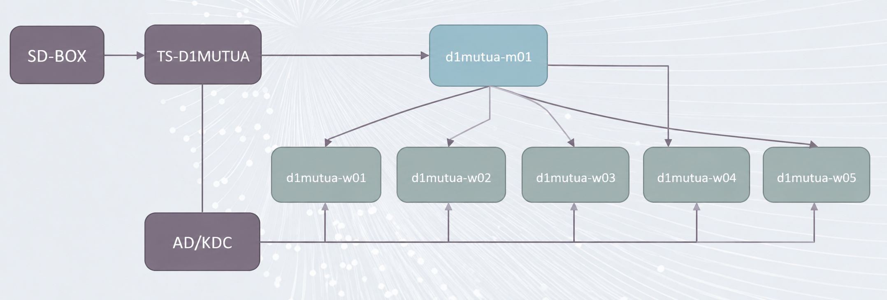

# CASD spark/hdfs cluster onboarding

This tutorial aims to help you to be familiar on how to use spark/hdfs cluster inside bulle D1MUTUA.

We will follow the below steps in this tutorial.

- understand the general architecture of the cluster
- check web interface access of the cluster
- check hdfs client of the cluster
- check spark client of the cluster
- check sparklyr client of the cluster

## 1. Architecture of the cluster

The below figure shows the general architecture of the cluster



- The `TS-D1MUTUA`: is the main server(Windows) which you connect to via the `SD-BOX`.
- The `d1mutua-m01, d1mutua-w01/w02/w03/w04/w05`: are the servers which form the spark/hdfs cluster. The end users can not access 
    them directly, but through spark/hdfs client which are installed/configured on `TS-D1MUTUA`.

## 2. Check web interface access of the cluster

This step happens inside the `TS-D1MUTUA` server (Windows).

You can visit the following url by using the `Firefox` web browser.

- [hdfs web interface](https://d1mutua-m01.casd.fr:50470/explorer.html) : is the web interface which allows users to view directories and data in the hdfs cluster.
- [spark web interface](https://d1mutua-m01.casd.fr:8090/cluster) : is the web interface which allows users to view spark jobs and available resources of the cluster. 

> There is a shortcut created in `Bureau`->`Raccourcis`->`Cluster`. You only need to double-click on it. A `Firefox` web browser
> will be opened automatically.
>
> The first connection may take few seconds, because of the kerberos ticket and user groups checking.
> You may also need to accept the certificat if you see warnings.
  
## 3. Install Spark, HDFS client

To facilitate the installation of Spark and HDFS client, CASD has developed an installation script. 

You can find this script in `C:\RO_Cluster\install_spark.ps1`.

Open a `powershell terminal`, and run the below command

```powershell
cd C:\RO_Cluster

#run the installation script
 .\install_spark.ps1
```

> After this step, you will be prompted with two questions: 
>   1. which spark version you want to install? choose 4.1.3 
>   2. Confirm you choice.
> If you encounter any error in this step. copy the error message and send to `datascience@casd.eu`


## 4. Check the hdfs client access

Open a new `powershell` terminal, and run the below command

```shell
# check the hdfs file system
hdfs dfs -ls /

# check user home folder, replace your_user_name by your current D1MUTUA user name(e.g. D1MUTUA_P_LIU0000).
hdfs dfs -ls /users/<your_user_name>

# for the first time, if you have not upload any data, the output will be empty.

# If you already have data, for example, for /users/D1MUTUA_P_LIU0000, you should see the below output
-rw-------+  3 D1MUTUA_P_LIU0000 hadoop         76 2026-03-06 11:18 /users/D1MUTUA_P_LIU0000/stats.csv
drwx------+  - D1MUTUA_P_LIU0000 hadoop          0 2026-03-10 17:16 /users/D1MUTUA_P_LIU0000/tmp
```

> You can only access your own home folder. If you try to access the home folder of other users, you should see `Permission denied` error.

You can also try to access the project folder

```shell
# check the projects folder
hdfs dfs -ls /projects

# try to access a project 
hdfs dfs -ls /projects/BCL_EEC
```

> If you are not in group `BCL_EEC`, you should see `Permission denied` error.


### 4.1 The demo folder

CASD has prepared some demo data and demo scripts to help user to use the spark cluster. To avoid conflicts between
users, we require you to **copy this demo Folder to your personnel documents folder**.

Use the same `powershell` terminal of the above section 4

```powershell
# copy demo folder
Copy-Item -Path "C:\Users\Public\Documents\demo" -Destination "$HOME\Documents" -Recurse

# goto your personnel documents folder
cd "$HOME\Documents\demo"

# check if you have the demo folder
ls
```

> You should see the contents of the demo folder in the output


### 4.2 transfer data between TS-D1MUTUA and HDFS cluster

As `spark` is a framework for distributed computing, the data must be also distributed. That's why `spark` can't use 
data from the local file system of `TS-D1MUTUA` server. As a result, we must transfer data from `local file system` 
to `hdfs cluster`

Use the same `powershell` terminal of the above section 4.1 

```shell
# check data in the local file system
ls 01-hdfs

# you should see stats.csv in the output.
# goto the 01-hdfs folder
cd 01-hdfs

# now upload data  from `local file system` to `hdfs cluster`
# replace your_user_name by your current D1MUTUA user name(e.g. D1MUTUA_P_LIU0000).
hdfs dfs -put stats.csv /users/<your_user_name>/

# check the data in hdfs
hdfs dfs -ls /users/<your_user_name>/

# download data from `hdfs cluster` to `local file system`
# "$HOME\Documents" means the `Documents` folder in `TS-D1MUTUA`
hdfs dfs -get /users/<your_user_name>/stats.csv "$HOME\Documents"
```

> The `TS-D1MUTUA` server is a Windows server, so the directory separator is `\`, the HDFS cluster servers
> are Linux servers, so the directory separator is `/`. When your data is in HDFS, use `/`, if your data is in 
> `TS-D1MUTUA`, use `\`.


## 5. Check the spark client access

In this section, we will test if you can use the spark client to connect to the cluster.
Use the same `Powershell terminal of section 4.1`.


First check if you have spark installed correctly in your environment. 

```shell
# check current spark runtime version
spark-submit --version

# you should see the below output
Welcome to
      ____              __
     / __/__  ___ _____/ /__
    _\ \/ _ \/ _ `/ __/  '_/
   /___/ .__/\_,_/_/ /_/\_\   version 4.1.3
      /_/
                        
Using Scala version 2.13.17, OpenJDK 64-Bit Server VM, 17.0.18
Branch HEAD
Compiled by user on 2026-07-12T02:17:43Z
...

```

### 5.1 Create and submit a spark job

We already created a pyspark job in `demo\02-spark-submit`, it's called `job1.py`.


```powershell
# go to the 02-spark-submit folder
cd "$HOME\Documents\demo\02-spark-submit"

# you can view the content of the job1.py
cat .\job1.py
```

To submit this job to the cluster, you need to run the below command
```shell
# don't forget to replace your_name
spark-submit --master yarn --deploy-mode cluster --name=test_spark_submit_<your_name> job1.py
```

> You can notice in the above `spark-submit` command, there are two important options
> - master is yarn : yarn is the resource manager(which job run on which worker).
> - deploy-mode cluster: spark driver will also run on the cluster side. So nothing runs inside 
> `TS-D1MUTUA` server. As a result, you don't need to activate python environment and pyspark
> You can check the status of your job via [yarn web UI](https://d1mutua-hdp-m01.casd.fr:8090/cluster).
> We will see how to `run spark in client mode` in the next section. 

> **The spark-submit only works in Powershell terminal**. 
 
> To make the cluster token management is completely transparent for the end user, CASD has written
> a script which overwrites the origin `spark-submit` command. This script is only activated in Powershell.
> As a result, the `spark-submit` command will ont work in `CMD terminal` .
> 

### 5.2 Use pySpark to connect to the spark cluster in interactive mode

We have seen how to submit jobs to the cluster. For exploring data, you may want to run your spark job interactively(client mode). 
In this mode the `spark driver` runs on `TS-D1MUTUA` server. So we need to install a `python virtual environment and pyspark`

To do so, we need to open an `anaconda terminal`. Goto `Raccourcis`-> `Python`, double-click on `Miniconda Prompt Python3.13`, 
you should see a popup `anaconda terminal`. Now you can run the below command to create a `python virtual environment`.

```shell
# check your python version
python -V

# create a virtual env with the current python interpreter version
conda create -n spark_venv python --offline

# list all existing virtual env
conda env list

# you should see spark_venv in the output

# activate the python virtual venv
conda activate spark_venv

# check installed libs
pip list

# install pyspark, the pyspark version must match the spark version in the cluster
pip install pyspark==4.1.3

# install jupyterlab
pip install jupyterlab
```

Now you have all the required dependencies to use spark cluster in interactive mode with `pyspark`.

> The `conda` command only visible in `anaconda terminal`. If you open a `powershell` or `cmd` terminal, the command `conda` 
> does not exit inside them. So if you want to use **python virtual environment**, you need to
> goto `Raccourcis`-> `Python`, double-click on `Miniconda Prompt Python3.13`, to open an `anaconda terminal`.
> 

To check if your installation is successful or not, let's close the existing `Miniconda Prompt Python3.13`, and open
a new one.

```powershell
# goto your Documents\demo\03-notebooks
cd Documents\demo\03-notebooks

# if you open a new `anaconda terminal`, don't forget to activate the `virtual environment(e.g. spark_venv)` 
conda activate spark_venv

# if you are already in the activated `virtual environment(e.g. spark_venv)`, you can run the below command
# to open a jupyter lab.
jupyter lab --port=0

# In the GUI, create a new jupyter notebook and copy the below code in it
```

> The option `--port=0` is very important. If you forget this option, you may see error messages `Port already in use`.
> Normally a browser will be launched automatically. If you don't see a browser, you can open a firefox and copy
> the jupyterlab url in the firefox.

In the notebooks, you should find a jupyter notebook called `01.pyspark_read_write_hdfs.ipynb`

You can run the blocks one by one and check the outputs of the blocks

The most important blocks are:
- importing CASD pyspark wrapper: The CASD pyspark wrapper take care of cluster authentication token automatically
- initiate spark session with CASD pyspark wrapper
- close the spark session

The below code shows a simple code example

```python
######### Import CASD pyspark wrapper ########
import getpass
import sys
from pathlib import Path

# Add CASD custom library path before imports
CASD_LIB_PATH = Path.home() / "AppData" / "Local" / "casd-tools" / "casd-token-conf"

# check before launch
if CASD_LIB_PATH.exists():
    sys.path.append(str(CASD_LIB_PATH))
else:
    print(f"[WARNING] Custom library path does not exist: {CASD_LIB_PATH}")
    
# import casd spark wrapper
from casd_spark import get_spark

############### initiate spark driver  ##############
# get user name
username = getpass.getuser()
# set spark job name
app_name = f"test_pyspark_for_{username}"

print(f"[INFO] Initializing Spark Session: {app_name}")
spark = get_spark(app_name=app_name)
```

The block 7 will write the result in CSV format in your hdfs home folder `/users/<user-name>/tmp/count_resu_csv`

The block 8 will write the result in Parquet format in your hdfs home folder `/users/<user-name>/tmp/count_resu_parquet`

The block 9 will do two import things:
1. Close the connection between your spark client and spark cluster, hence free all the reserved resource in the cluster.
2. Revoke the authentication token which allows you to connect to the cluster. It means you cannot create a new spark session
on the cluster anymore. To generate a new authentication token, you need to click on the `Restart the kernel` button.

### 5.3 Use sparklyr to connect to the spark cluster in interactive mode()

To use sparklyr with the kerberos authentication in Windows, we also need a CASD sparklyr wrapper. This wrapper takes
care of the cluster authentication token lifecycle.

You can find a complete R script in `Documents\demo\04-sparklyr`, which allows you to create a spark session with sparklyr
on the cluster and read data from HDFS, and write results on the HDFS

This script has four important blocks
- Importing CASD sparklyr wrapper
- Configure spark session parameters(e.g. worker number, CPU and memory per worker, etc.)
- Initiate spark session with CASD sparklyr wrapper
- Close the spark session

The below R script shows how to import CASD sparklyr wrapper
```R
# The wrapper reqires the below packages, you only need to install it once
install.packages("sparklyr")
install.packages("dplyr")

# Dynamically extract the current username
current_user <- Sys.info()[["user"]]
message(sprintf("Running Spark session for OS User: %s", current_user))

# Construct CASD sparklyr wrapper path
casd_conf_path <- file.path(
  "C:", "Users", current_user, "AppData", "Local", 
   "casd-tools", "casd-token-conf", "casd_spark.R"
)
# import CASD sparklyr wrapper
if (file.exists(casd_conf_path)) {
  source(casd_conf_path, encoding = "UTF-8")
} else {
  stop(sprintf("Configuration script not found at expected path: %s", casd_conf_path))
}
# import the required package
library(sparklyr)
library(dplyr)
```

Now we need to configure the cluster parameters

```R
# Safe connection state tracking
sc <- NULL

# Ensure YARN application containers are cleaned up even if the script throws an error
on.exit({
  if (!is.null(sc) && connection_is_open(sc)) {
    message("Closing Spark connection and releasing YARN resources...")
    casd_spark_disconnect(sc)
  }
}, add = TRUE)

# ==============================================================================
# 1. Cluster Configuration & Network Settings
# ==============================================================================
config <- spark_config()

# YARN Resource Allocation
config$spark.executor.instances <- 2
config$spark.executor.cores     <- 1
config$spark.executor.memory    <- "2g"
config$spark.driver.memory      <- "2g"

# Network & Connectivity
config$spark.driver.bindAddress <- "0.0.0.0"
config$spark.submit.deployMode  <- "client"


# Security Tokens for HDFS and Hive metastore delegation
config$spark.yarn.security.tokens.hdfs.enabled <- "true"
config$spark.yarn.security.tokens.hive.enabled <- "true"
```
Now we have all we need to initiate a spark session, let's start our spark session. This may take few seconds, please be
patient.

```R
# Establish YARN Connection
sc <- casd_spark_connect(master = "yarn", config = config)
```

> You may see some error messages about when sparklyr updating Rstudio connection pane: Rstudio can't find log file `logs/log4j.spark.log`
> This error message does not impact the execution of your sparklyr code, you can just ignore it

Once the spark session is created, you can do your usual sparklyr data analysis, this is zero syntaxe change.

After you finish your analysis, you need to close your spark session. Otherwise, the reserved resource will never be
freed.

```R
# close the spark session and free the resources
casd_spark_disconnect(sc)
```

> If you want to restart a spark session, you need to restart the R kernel to generate a new cluster authentication token.


